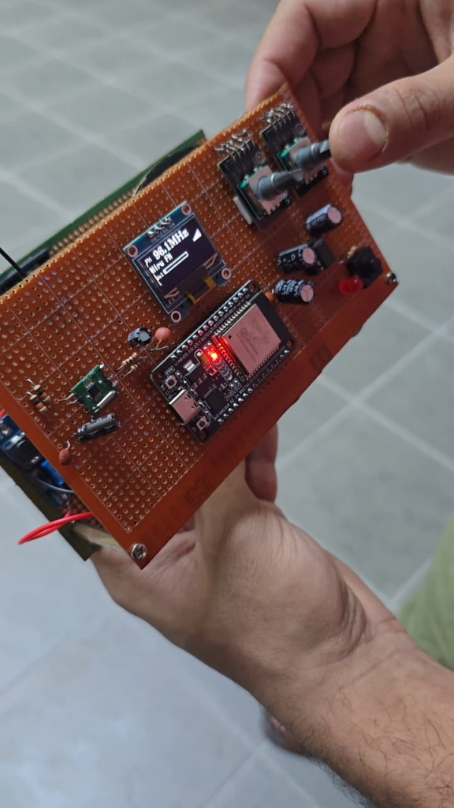
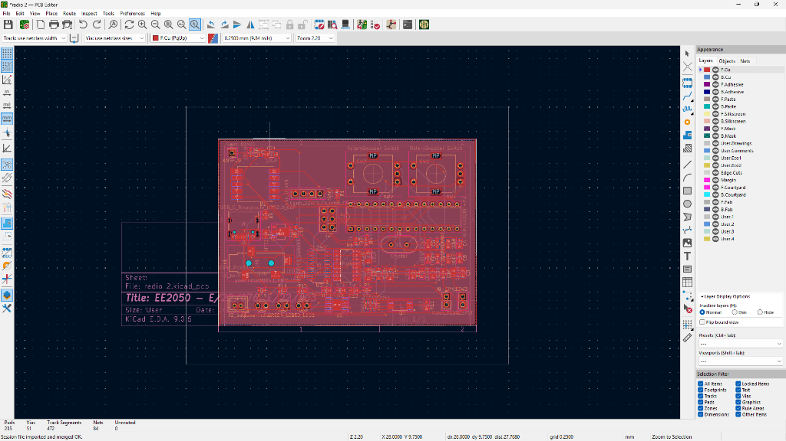
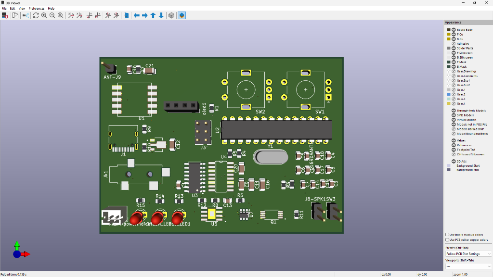

# FM Pocket Radio

This repository contains the complete design and documentation for an FM Pocket Radio project, developed as part of the **EE2050 Product Development** module at the University of Peradeniya (Semester 3).

The project demonstrates an iterative engineering approach, evolving from an initial proof-of-concept perfboard build to an ESP32-powered dot-board prototype with an OLED UI, and finally into a custom mixed-signal 2-layer PCB design.

## Project Structure
- **[FM_Pocket_Radio_Report.pdf](FM_Pocket_Radio_Report.pdf)**: Complete engineering report covering system architecture, circuit schematics, hardware iterations, and debugging logs.
- **[radio 2.kicad_pcb](radio%202.kicad_pcb)**: KiCad 9.0 PCB layout for the final Phase 3 custom 2-layer board (70 x 50 mm).
- **images/**: High-resolution prototype photos, KiCad schematics, and 2D/3D board renders.

## Highlights
- **Iterative Hardware Evolution**:
  - **Iteration 1 (Proof of Concept)**: Arduino UNO + RDA5807M FM receiver + TDA2822M audio amplifier on perfboard.
  - **Iteration 2 (Dot Board Prototype)**: ESP32 DevKit + RDA5807M + TDA2822M (BTL mode) + SH1106 1.3" OLED display + dual rotary encoders + 18650 Li-ion battery. Features a 68-station Sri Lankan FM station database and dynamic UI.
  - **Iteration 3 (Custom PCB)**: Standalone ATmega328P microcontroller + RDA5807M + PAM8403 Class-D stereo amplifier + CH340C USB-UART bridge + TP4056/DW01A battery management + single USB-C port for power, charging, and flashing.
- **Documentation**: See [FM_Pocket_Radio_Report.pdf](FM_Pocket_Radio_Report.pdf) for a deep dive into the technical architecture, challenges, and iterative prototyping process.

## Prototypes & PCB Design

### Iteration 2: Working Hardware Prototype
Fully working dot-board prototype with OLED station readout, rotary volume and tuning control, and integrated battery management.

### Iteration 3: KiCad PCB Design (2D Layout & 3D Render)
Custom 2-layer 70 x 50 mm PCB with dedicated analog, digital, and power zone isolation.

---
*Authored by Shya-Bubu*
